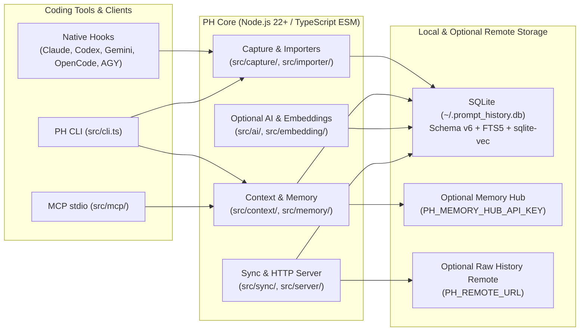
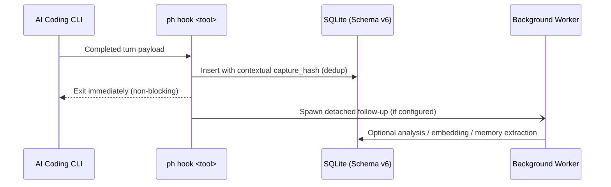

# PH Architecture

PH is a local-first plain-text CLI, SQLite store, and stdio MCP server for capturing AI coding interactions and retrieving project context.

## Component Overview

## Capture and Context Flow

## Storage & Security Boundaries

- **Local-first by default:** interactions stay in `~/.prompt_history.db` (SQLite + FTS5 + optional `sqlite-vec` partitioned by `project`).
- **Sensitive records:** personal and sensitive memories are excluded from default `ph context`, `ph search`, and MCP responses.
- **Separated remote channels:** `PH_MEMORY_HUB_API_KEY` syncs only derived work/project memories (with local `pending` queue fallback); `PH_REMOTE_URL` is a separate explicit opt-in for raw history push/pull.

## Further Reading

- [User Manual](ph-manual.md)
- [Capture Hook Guide](hooks.md)
- [Memory Hub Operations](memory-hub.md)
- [Feature Specifications](specs/SPEC-INDEX.md)
